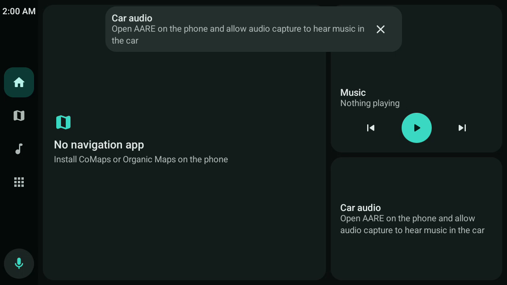

# AARE

AARE is an open-source reimplementation of the phone side of Android Auto. The phone talks the
Android Auto projection protocol (AAP) to the car's head unit, draws the car screen itself, and
runs apps that Google's Android Auto keeps out:

- **Navigation:** CoMaps, Organic Maps and other apps built with the AndroidX Car App Library,
  F-Droid builds included.
- **Media:** Tempus (Subsonic/Navidrome) and any app with a media3 or `MediaBrowserService`
  library: podcasts, radio, local players.
- **Messaging:** WhatsApp, Signal, SMS and any app whose notifications Android Auto can read:
  conversations read aloud, marked as read, answered with the car keyboard when parked.
- **Voice assistant:** the steering-wheel voice button opens the phone's default digital
  assistant, or another one you pick. Assistants with a car app, such as
  [Lapin](https://github.com/prototux/lapin), run on the car screen and hear the car's microphone.

It needs no Google Play Services.



> [!WARNING]
> **This is early software.** The protocol stack is tested against a simulated head unit, against
> AARE's own desktop head unit and against Google's Desktop Head Unit up to the certificate check
> (see below). It has not been tried in a real car yet. Don't depend on it while driving until
> you have.

## What works

| Part | State |
|---|---|
| Protocol: framing, TLS 1.2 (phone = server), version, service discovery, channels | done, unit and loopback tests |
| Video: H.264 hardware encoding of a private virtual display, ack flow control, focus, key-frame recovery | done |
| Touch, keys, rotary controller, steering-wheel voice/media/home/back keys | done |
| Sensors: driving restrictions, night mode, car GPS and compass (passed to nav apps) | done |
| Car App Library host: handshake, templates, map surface, navigation trips, alerts, car hardware, microphone | done |
| Template rendering (list, grid, pane, message, search, sign-in, tabs, navigation, map...) | done |
| Media apps: browse, search, now playing, transport, active session tracking | done |
| Messaging apps: conversations from notifications, read aloud, mark as read, reply when parked | new |
| Turn-by-turn to the instrument cluster and now-playing to the head unit | done |
| Directions from Google Maps, Waze… on the phone, on the dashboard and the cluster | new, untested with Google Maps and Waze |
| Phone screen in the car, with touch | new, untested on hardware |
| Phone audio to the car (music, podcasts, assistant answers) | done, needs one capture consent |
| Car microphone to apps (any `CarAudioRecord` app) | done |
| USB (AOA) | done |
| Wireless (Bluetooth bootstrap + Wi-Fi + TCP) | done, untested on hardware |
| Developer head-unit server on TCP 5277 (DHU, openauto, Headunit Revived) | done |

## Requirements

- A phone with **Android 10** or newer.
- A head unit that accepts AARE's certificate (see *Compatibility*), or a computer to run the
  desktop head unit.

## Installing

There are no release builds yet: build the APK yourself (see *Building*) and install it with
`adb install -r app/build/outputs/apk/debug/app-debug.apk`.

## Using it

1. Open AARE on the phone and go through *Setup*:
   - **Permissions.**
   - **Notification access:** for messages and now playing.
   - **Car audio and phone screen:** one screen-capture consent (choose *Entire screen*), for
     the phone's sound in the car and the *Phone screen* app.
   - **Touch on the phone screen** (optional): AARE's accessibility service.
2. Optionally, under *Voice assistant*, choose what the voice button opens (by default, the same
   assistant as the phone).
3. Plug the phone into the car's Android Auto USB port. For wireless, pair it with the car over
   Bluetooth first.
4. To try it without a car, tap **Preview car screen**: it shows the car UI on the phone with the
   same apps, or use the desktop head unit below.

The bar is on the driver's side (or left, right or at the bottom: *Car screen* in the settings) and holds:

- the clock
- home (the dashboard: map or directions, and media)
- the current navigation app
- the current media app
- all apps
- the assistant (also the steering-wheel voice button)

### Which apps appear

| Kind of app | Found by | In AARE |
|---|---|---|
| Car App Library apps (CoMaps, Organic Maps, OsmAnd, EV charging…) | `androidx.car.app.CarAppService` | yes |
| Media apps | `MediaBrowserService` / media3 `MediaLibraryService` | yes |
| Messaging apps | `<uses name="notification"/>` in `automotive_app_desc`, and the default SMS app | yes, from their notifications |
| Google Maps, Waze and other apps on Google's private car interface | Android Auto only | no |

Some apps, Google Maps and Waze among them, draw their car screen through an undocumented
interface that only Google's Android Auto app can host, and they check that the host is Google's.
AARE can't host them. AARE's settings list every app that declares Android Auto support but that
AARE can't show, with the reason. Two things make up for it:

- **Their directions in the car.** While Google Maps, Waze or another app guides you on the
  phone, AARE reads its navigation notification and shows the next turn, the distance and the
  arrival time on the dashboard and on the car's instrument cluster. Their voice prompts reach
  the car through the phone's Bluetooth link.
- **Phone screen.** An entry in the car's app list that shows the phone's own screen, so you can
  use those apps from the car:
  - it uses the screen-capture permission of *Car audio and phone screen* (choose *Entire
    screen* when Android asks);
  - touching it needs AARE's accessibility service (*Touch on the phone screen* in *Setup*;
    for a sideloaded APK, Android may first ask you to *Allow restricted settings* in AARE's
    app info);
  - the phone must stay unlocked, and the picture is the phone's, in portrait unless you turn
    the phone;
  - while driving it is paused unless a navigation app is in front and guiding.

### Voice assistant

| Choice | What the voice button does |
|---|---|
| **Same as the phone** (default) | opens the phone's default digital assistant (*Settings > Apps > Default apps > Digital assistant*) |
| an assistant with a car app (e.g. Lapin) | opens it on the car screen and asks it to listen; it hears the car's microphone |
| any other assistant | opens it on the phone; it uses the phone's microphone |

Opening an assistant on the phone is best effort: Android may not let AARE bring an app to the
front while the phone is locked or AARE is in the background. An assistant with a car app works
best.

## Testing without a car: the desktop head unit

`./headunit.sh` turns your computer into a car for a phone or emulator connected with adb. You
need `adb` (Android SDK platform-tools), `ffmpeg` and a JDK 17-21.

1. On the phone, turn on USB debugging and plug it into the computer.
2. Install a **debug** build of AARE (`./build.sh && adb install -r app/build/outputs/apk/debug/app-debug.apk`).
3. Run `./headunit.sh`.

The script forwards TCP 5277 over adb, switches on AARE's head-unit server (debug builds do it
when asked; on release builds, turn on *Head unit server* in AARE's settings), builds the
desktop head unit and opens a window showing the car screen.

```sh
./headunit.sh                       # AARE, through AARE's desktop head unit
./headunit.sh google                # the official Android Auto app, through Google's Desktop Head Unit
./headunit.sh --res 1920x1080 --time-scale 10 --speed 110 --rhd
```

| On the computer | In the car |
|---|---|
| mouse | the touch screen |
| Esc / Backspace | back |
| H | home |
| V | the steering-wheel voice button |
| wheel / arrows | rotary controller |
| K / `,` / `.` | play-pause / previous / next |
| N / P | night mode / parked |

The window also gives you:

- **Audio:** the car's audio channels play on your speakers.
- **Microphone:** your microphone becomes the car's microphone, so you can talk to the assistant.
- **Side panel:** the phone's turn-by-turn instructions and now playing.
- **Simulated drive:** follows a real 775 km **Paris → Marseille** route (OpenStreetMap data via
  OSRM), slower in towns, with pause and ×10 / ×60 / ×300 time acceleration. It is sent as the
  car's GPS, speed and gear.
- **Emulator GPS:** on an emulator, the phone's own GPS is moved along the route too, so apps
  that use the phone's location (CoMaps) follow it.
- **Headless mode:** `--headless DIR --script "tap:640,360@10 key:4@12"` runs without a window
  and saves screenshots, for automated tests.

**Google mode** runs Google's Desktop Head Unit, downloading it if needed, with the same drive on
an emulator's GPS. The official app only accepts head units with a Google-issued head-unit
certificate, which AARE doesn't include, so Google's own tool is the way to compare. Turn on
*Start head unit server* in Android Auto's developer settings first. AARE's head unit can also
present a head-unit certificate you supply (`--hu-cert`, `--hu-key`).

Other tools:

- `./gradlew :aap:runPhoneSim --args="test.h264"`: a desktop "phone" that serves an H.264 file
  on TCP 5277, to exercise head-unit software.
- `./build.sh :aap:test`: protocol tests, including full sessions against a simulated head unit.

## Compatibility: read this before trying it in a car

### Phone certificate

During the handshake the head unit checks the phone's TLS certificate.

- **Google's head unit library:** Google's Desktop Head Unit and head units built on Google's
  receiver library accept only a phone certificate issued by Google's "Google Automotive Link"
  CA. AARE was tested against Google's DHU: the TLS handshake completes, then the head unit
  refuses authentication (status -3).
- **Open-source head units:** openauto/Crankshaft, Headunit Revived, LIVI and aa-proxy-rs accept
  AARE's generated certificate, as do some OEM units.
- **Importing a certificate:** AARE does not ship or extract Google's key. If you have a
  certificate and key you're entitled to use, import it under *Phone certificates*.
- **Fallback order:** AARE offers its certificates in turn. After a head unit rejects one, the
  next connection uses the next one.

### Car apps that only trust Google

A Car App Library app decides which hosts it accepts (`HostValidator`).

- **Debug builds** of most apps accept any host.
- **Release builds:** apps built with car-app library 1.8.0-beta01 or older also accept a host
  holding `android.car.permission.TEMPLATE_RENDERER`. AARE holds it, so CoMaps (1.7.0), Organic
  Maps (1.8.0-alpha02) and Lapin (1.7.0) work today.
- **Newer library versions** dropped that path on phones. Those apps need AARE's signing
  certificate digest in their allow-list:

  ```kotlin
  HostValidator.Builder(context)
      .addAllowedHosts(androidx.car.app.R.array.hosts_allowlist_sample)
      .addAllowedHost("net.prototux.aare", "<sha256 of AARE's signing certificate>")
      .build()
  ```

  Get the digest with `apksigner verify --print-certs app-release.apk`. For apps you build
  yourself, add it to their allow-list. For others, ask upstream.

### Audio

- **What can be captured:** Android only lets a normal app capture other apps' sound through
  playback capture, which covers media, games and "unknown". This includes music, podcasts and
  the spoken answers of assistants such as Lapin.
- **Navigation voice prompts** (`USAGE_ASSISTANCE_NAVIGATION_GUIDANCE`) can only be captured by
  a privileged app. On a normal install they stay on the phone or its Bluetooth link.
- **Calls** go through Bluetooth (HFP), as with Android Auto.

### Coexisting with Google's Android Auto

- **USB:** both apps answer the same USB accessory, so Android asks which one to use. Choose
  AARE and "always", or disable Android Auto.
- **Permissions:** AARE never redeclares the permissions Android Auto defines, so both can be
  installed.

## Building

You need a JDK 17-21 and the Android SDK (Android Studio installs both).

```sh
echo "sdk.dir=$HOME/Android/Sdk" > local.properties   # or set ANDROID_HOME
./build.sh                    # debug APK: app/build/outputs/apk/debug/app-debug.apk
./build.sh :aap:test          # protocol tests: framing, TLS, a full session against a simulated head unit
./build.sh :app:testDebugUnitTest
```

`build.sh` finds a suitable JDK and runs Gradle. On a machine without swap, set
`AARE_BUILD_MEMORY=5G` to run the build in a memory-capped systemd scope. Opening the project
in Android Studio works too.

## Layout

| Folder | What |
|---|---|
| `aap/` | the protocol, pure Kotlin/JVM: framing, TLS, session, channels, wireless bootstrap, simulators and tests |
| `aap/src/main/proto/` | AAP protobuf definitions, from [aasdk](https://github.com/opencardev/aasdk) |
| `app/.../car/` | a projection session: video, input, sensors, audio, microphone, cluster |
| `app/.../host/` | the Car App Library host, the car runtime (app list, routing, UI root) and assistant selection |
| `app/.../host/templates/` | Compose rendering of car app templates |
| `app/.../media/` | media apps: discovery, media3 browser, now playing, UI |
| `app/.../mirror/` | the *Phone screen* app: mirroring and touch |
| `app/.../notify/` | notifications: messaging apps, and directions from navigation apps on the phone |
| `app/.../transport/` | USB accessory, TCP server, wireless (Bluetooth + Wi-Fi) |
| `app/.../ui/` | phone UI, car shell (rail, dashboard, launcher), theme |
| `headunit/` | the desktop head unit (`./headunit.sh`) |
| `docs/research/` | protocol notes: Android Auto app, reference projects, car app hosting |

## Contributing

Bug reports and pull requests are welcome. Reports from real cars are the most useful: say which
head unit (make, model, year, or the open-source software it runs), USB or wireless, and attach
`adb logcat` output around the connection (`adb logcat | grep -i aare`).

Before sending a pull request, run `./build.sh :aap:test` and build the app.

## License

GPL-3.0-or-later (see [LICENSE](LICENSE)). The protobuf definitions come from aasdk
(GPL-3.0-or-later, see [aap/src/main/proto/NOTICE.md](aap/src/main/proto/NOTICE.md)).

Not affiliated with or endorsed by Google. Android Auto is a trademark of Google LLC.
